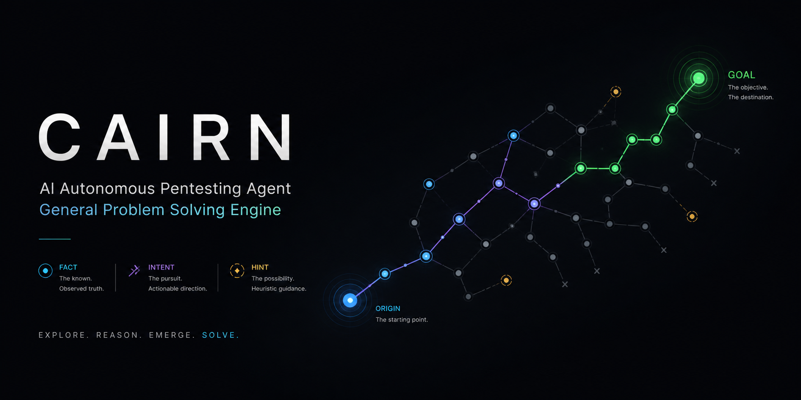

<div align="center">

# AXIOM
### 不只是 AI 渗透测试 —— 面向通用状态空间搜索

AXIOM 是一个通用问题求解引擎。<br/>它不定义角色，不预设工作流。给定一个起点和一个目标，它在未知状态空间中搜索通路。<br/>AI 渗透测试是其被验证的第一个领域。

</div>

<p align="center">
  
</p>

## AXIOM 是什么？

渗透测试本质上是在**近乎无限的状态空间中进行有向搜索**：

- **起点（Origin）**：已知（目标 IP、目标系统）
- **目标（Goal）**：明确（获取 shell、拿到 flag）
- **路径（Path）**：未知

这种结构并非渗透测试独有。漏洞研究、数学证明、CTF 挑战赛——任何具有清晰起点、明确成功条件、以及未知中间路径的问题，都具备同样的形态。

AXIOM 正是为这类问题而生。渗透测试是它被首个验证的领域。

引擎基于**黑板架构（Blackboard Architecture）**，以显式的事实-意图图为核心。三个基本原语即可支撑全部运作：

| 概念 | 含义 |
|------|------|
| **Fact（事实）** | 已确认的客观发现，写入黑板 |
| **Intent（意图）** | 已声明的探索方向，尚未执行 |
| **Hint（提示）** | 随时可注入的人工判断，由 Agent 在下次读取时吸收 |

图从 `origin`（起点）向 `goal`（目标）生长。每一个新 Fact 都是踏脚石，每一个 Intent 都是迈向未知的一步。

Agent Worker 运行 OODA 循环——Observe（观察全图）、Orient（定位当前状态）、Decide（决定下一步意图）、Act（执行探索）——并将发现以新 Fact 写回。Worker 没有固定角色，任务在运行时根据图的当前状态动态生成，而非来自预定义的职责描述。

Agent 之间仅通过共享黑板协调（信息素协调/Stigmergy），无直接通信，无信息孤岛。

## 架构原理

三种任务类型，全部由同一种 Worker 执行：

| 任务 | 功能 | 输出 |
|------|------|------|
| **Bootstrap** | 项目启动时，尝试直接解决问题 | Fact + 可能的 Complete |
| **Reason** | 读取完整图：目标是否达成？下一步应探索什么？ | Complete / 新 Intent / 无操作 |
| **Explore** | 认领一个 Intent，执行探索，汇报发现 | 一个 Fact |

系统架构：

```
          ┌──────────────────────────────────┐
          │           AXIOM Server           │
          │    Facts + Intents + Hints       │
          └─────────────────┬────────────────┘
                            │
                     Read / Write API
                            │
          ┌─────────────────┴────────────────┐
          │             Dispatcher           │
          │   调度任务、管理容器、维护协议    │
          └──────────┬───────────────┬───────┘
                     │               │
     ┌───────────────┴──┐     ┌──────┴──────────────┐
     │  Worker 容器      │     │  Worker 容器         │
     │   (项目 A)        │     │   (项目 B)           │
     │  ┌────┐  ┌────┐  │     │  ┌────┐  ┌────┐     │
     │  │ W. │  │ W. │  │     │  │ W. │  │ W. │     │
     │  └────┘  └────┘  │     │  └────┘  └────┘     │
     └──────────────────┘     └─────────────────────┘
```

**AXIOM Server** 仅维护图的一致性。

**AXIOM Dispatcher** 读取图、调度任务、启停 Worker 容器、独占写入协议。每个项目拥有独立的 Worker 容器，其中多个 Agent Worker 并发运行。Agent Worker 只接收 Prompt、返回结构化输出。

支持的 Worker 后端：**Claude Code**、**Codex**、**Pi**。

## 实测结果

在某顶级 AI 安全挑战赛（610 支队伍，1345 名参赛者，涵盖国内顶尖高校与安全企业）中：

| 指标 | 数值 |
|------|------|
| 题目解出数 | **54 / 54（全场唯一 AK）** |
| 最终排名 | 第 3 名 |

> 系统在比赛前从未完整测试过。完整 pipeline 在比赛当天凌晨 4 点首次上线。无训练、无调参、无任何领域专用工具。零 MCP 工具、零 RAG、零预定义 Agent 角色。

## 快速开始

**环境要求**

- macOS 或 Linux
- Python ≥ 3.12
- Docker

### 拉取所需镜像

两种部署方式都需要 Worker 容器镜像（需自行构建或联系维护者获取）。

创建本地 Dispatcher 配置并填写 LLM 端点和 API Key：

```bash
cp dispatch.example.yaml dispatch.yaml
```

### Docker Compose（推荐）

```bash
docker compose up --build
```

启动后：`axiom-server` 监听 `8000` 端口，`axiom-dispatcher` 在 server 通过健康检查后启动。Dispatcher 从项目根目录挂载 `dispatch.yaml`，通过 host socket 连接 Docker。数据持久化到 `./datas/cairn/`。

### 手动启动

```bash
# 启动 server
uv run --project cairn cairn serve

# 运行 dispatcher
uv run --project cairn cairn dispatch --config dispatch.yaml

# 仅执行启动健康检查
uv run --project cairn cairn dispatch --config dispatch.yaml --startup-healthcheck-only
```

### 测试

无需 Docker 或在线模型端点的快速回归测试：

```bash
uv run --project cairn --group dev pytest
```

## 免责声明

AXIOM 是通用问题求解引擎。尽管其支持渗透测试、CTF 解题、安全评估及漏洞研究等工作流，但仅应在**明确获得授权**的环境中使用。

您需为自己使用本项目的方式独立承担全部责任。未经系统、网络、应用或数据的所有者或运营方明确授权，请勿对其进行任何安全测试。未经授权的安全测试、漏洞利用或数据访问可能违法，并可能造成损害。

本项目的开发者和贡献者不认可、不接受因任何误用、滥用、损坏、损失或法律后果所产生的责任。使用本项目即表示您同意确保所有活动符合您所在司法管辖区内适用的法律法规、合同义务及专业/组织政策。

## ⚖️ 许可证

本项目依据 **GNU AGPLv3** 授权，供个人及教育用途使用。
