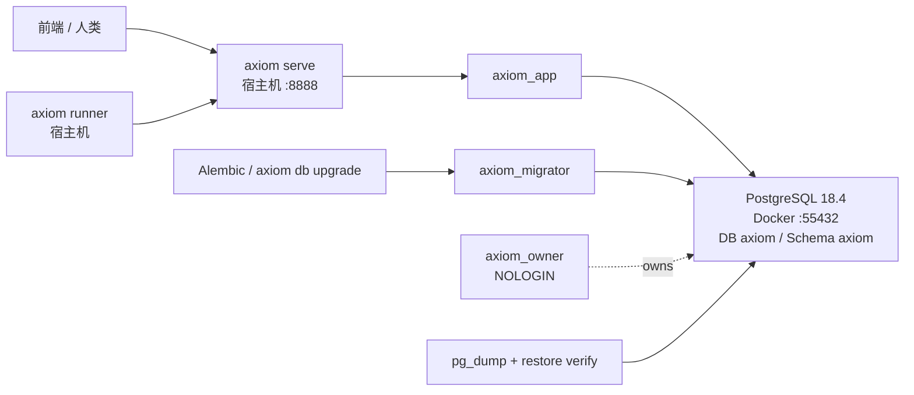

# AXIOM SQLite → PostgreSQL 原生化与生产切换

> 状态：生产已切换并开放 PostgreSQL 写入；24 小时观察仍由 LaunchAgent 持续执行。本文记录已经落地的实现与证据，不把观察期提前标记为完成。

## 1. 最终结果

AXIOM 的生产、开发和普通测试运行时已经统一为 PostgreSQL：

```text
API/Runner 代码： /Users/hexin/vscode/xrayAI/axiom
API：            http://127.0.0.1:8888
PostgreSQL：     127.0.0.1:55432/axiom
业务 Schema：    axiom
Alembic：        20260805_pg0001（postgresql@head）
数据目录：       /Users/hexin/.local/share/axiom-v3
环境文件：       /Users/hexin/.local/share/axiom-v3/postgresql.env（0600）
```

SQLite 不再参与运行时：

- API、Runner、Alembic 和普通 pytest 不会创建或连接 SQLite；
- 运行时 Engine 工厂拒绝非 PostgreSQL URL；
- `--db-path` 不再是 API/Runner 参数；
- SQLite 只保留为只读历史备份和 `axiom db migrate-sqlite` 的输入。

生产切换相关 Git 提交：

```text
87c3549  feat: migrate AXIOM runtime to PostgreSQL
680e956  ops: harden PostgreSQL cutover and restore verification
7d0c772  ops: load PostgreSQL credentials from restricted env files
d831144  ops: supervise post-cutover PostgreSQL observation
```

## 2. PostgreSQL 运行架构



数据库镜像固定为 PostgreSQL 18.4 Debian 镜像及不可变 digest。宿主机通过 `127.0.0.1:55432` 连接；未来 API/Runner 容器化时可通过 Compose 网络的 `postgres:5432` 连接。

角色边界：

| 角色 | 登录 | 用途 |
|---|---:|---|
| `axiom_owner` | 否 | 拥有 `axiom` Schema 和业务对象 |
| `axiom_migrator` | 是 | `SET ROLE axiom_owner` 后运行 Alembic |
| `axiom_app` | 是 | API/Runner 的业务读写，不允许修改 Schema |

`public` Schema 的公共 `CREATE` 权限已回收。密码和业务凭据按既定要求明文保存，不增加应用层加密、主密钥、外部 Secret 引用或接口脱敏；运行配置文件和 LaunchAgent plist 依赖 `0600` 文件权限保护。

## 3. 数据类型和兼容层

- JSON 配置、Payload 和所有 `*_json` 使用 PostgreSQL `JSONB`；
- 时间字段使用 `TIMESTAMPTZ`，连接时固定 UTC；
- 布尔值使用原生 `BOOLEAN`；
- 状态值继续使用 `VARCHAR + CHECK`，不使用 PostgreSQL ENUM；
- `t_XXX`、`iXXX`、`fXXX` 等字符串 ID 保持不变；
- `id_counters` 保留，分配使用原子更新与 `RETURNING`；
- MCP Tool 参数顺序使用私有 `x-axiom-property-order` 注解保存，避免 JSONB 对象键顺序影响模型看到的工具签名。

服务层历史上把 JSON 和时间作为字符串处理。为避免一次性改写全部模块：

- `JSONText` 在数据库中存 JSONB，在 Python 边界返回规范化 JSON 字符串；
- `UTCDateTimeText` 在数据库中存 aware datetime，在 Python/HTTP 边界返回 UTC ISO-8601 字符串。

这两个 TypeDecorator 是兼容层，不改变 PostgreSQL 的真实存储类型。

## 4. PostgreSQL 并发原生化

Dispatcher 的领取路径已经从 SQLite 全局写锁切换为 PostgreSQL 行锁：

```sql
SELECT ... FOR UPDATE SKIP LOCKED
```

Intent、ReasonRun 和 ReviewRun 的“候选选择 → 状态变更 → Lease 创建”处于同一事务。多个 API 事务不会领取同一个工作项，也不会因一个被锁定的候选阻塞整个领取队列。

事务层对以下 SQLSTATE 最多重试三次，并加入短抖动：

```text
40P01  deadlock_detected
40001  serialization_failure
```

Engine 启用：

- `pool_pre_ping`；
- 连接超时；
- `lock_timeout`；
- `idle_in_transaction_session_timeout`；
- `application_name`；
- UTC Session 时区。

运行时代码已移除 `BEGIN IMMEDIATE`、PRAGMA、SQLite UPSERT 方言、`INSERT OR IGNORE`、`sqlite_where` 和 SQLite 文件锁。冲突写入使用明确约束的 PostgreSQL `ON CONFLICT`；搜索、NULL 排序和 JSON 比较不再依赖 SQLite 隐式行为。

## 5. Alembic 分支

SQLite 历史 Head 冻结为：

```text
20260805_0035
```

已有 35 个 SQLite 迁移保持原样，不尝试在 PostgreSQL 上重放。PostgreSQL 从独立基线开始：

```text
revision:     20260805_pg0001
branch label: postgresql
deploy head:  postgresql@head
```

空数据库已经验证：

```text
upgrade postgresql@head
→ downgrade base
→ upgrade postgresql@head
```

`axiom serve` 不隐式迁移数据库；业务表缺失或数据库 revision 不是当前 Head 时会拒绝启动并提示运行 `axiom db upgrade`。

## 6. SQLite 一次性导入器

命令：

```bash
axiom db migrate-sqlite \
  --sqlite-path /path/to/axiom.db \
  --database-url postgresql+psycopg://... \
  --data-dir /path/to/source-data \
  --report-dir /path/to/report
```

### 导入前门禁

1. 使用只读 URI 打开 SQLite；
2. 要求 Alembic 版本精确为 `20260805_0035`；
3. 执行 `integrity_check` 和 `foreign_key_check`；
4. 校验表、列、JSON、时间和业务 ID；
5. 要求 PostgreSQL 已安装正确基线且所有业务表为空。

### 导入事务

- 按 SQLAlchemy metadata 的外键拓扑导入 36 张业务表；
- 全部业务行位于一个 PostgreSQL 事务；
- 保留所有主键、字符串 ID、状态、Lease、ReasonRun、Goal Cycle、Archive Batch、ReviewRun、Audit、Token Usage 和明文配置；
- SQLite 无时区时间按 AXIOM 历史 UTC 约定转为 `TIMESTAMPTZ`；
- Artifact 文件不复制，只迁移元数据和原路径；
- 源端 Counter 会提升到不小于实际最大业务 ID 的安全值；
- 导入后执行 PostgreSQL 约束检查和 `ANALYZE`。

### 一致性报告

导入器同时生成 JSON 与 Markdown 报告，记录：

- 每表源端/目标端行数；
- 按主键排序、类型规范化后的 SHA-256；
- JSON、约束和 Counter 结果；
- Artifact 文件存在性；
- 导入耗时和失败位置。

任一不一致都会抛错并回滚整个 PostgreSQL 事务，不能带警告继续上线。目标非空时也会拒绝重复导入。

## 7. 两次完整演练

使用两个不同时间取得的生产 SQLite 副本，从空 PostgreSQL 完整执行基线、导入、fingerprint、frozen API 启动和快照比较：

```text
/Users/hexin/.local/share/axiom-v3/postgresql-migration/rehearsal-pg18-1d-20260805T180356Z
/Users/hexin/.local/share/axiom-v3/postgresql-migration/rehearsal-pg18-2b-20260805T181943Z
```

两次结果一致：

- 数据库全表 hash：PASS；
- SQLite/PostgreSQL API section hash：PASS；
- Artifact 文件：3,547 / 3,547；
- Counter 自动调整：0；
- 演练数据库在完成后销毁。

## 8. 正式生产切换

切换报告目录：

```text
/Users/hexin/.local/share/axiom-v3/postgresql-migration/cutover-20260805T183453Z
```

正式流程：

1. 将维护状态设为 `drain`；
2. 临时禁用 Worker，等待全部活动 Lease 清空；
3. 恢复持久化 Worker 配置，依次停止 Runner 和 API；
4. 使用 APSW 内置 SQLite 3.51.3 完成最终 checkpoint 和不可变备份；
5. 对冻结 SQLite 启动只读旧 API，导出规范化 API 快照；
6. 初始化空 PostgreSQL，执行 `postgresql@head`；
7. 运行只读导入器并计算全表 fingerprint；
8. 在 `frozen` 下启动 PostgreSQL API，导出同口径快照并逐 section 比较；
9. 创建首次 `pg_dump`，恢复到新数据库并要求 fingerprint 完全一致；
10. 启动正式 PostgreSQL API/Runner，开放写入；
11. 安装每日备份和 24 小时观察 LaunchAgent。

最终结果：

- 36 张业务表全部计数和 SHA-256 匹配；
- 3,547 个 Artifact 文件全部存在；
- SQLite/PostgreSQL API 全 section hash 一致；
- 首次 PostgreSQL 备份恢复 fingerprint 完全一致；
- Alembic 为 `20260805_pg0001`；
- 生产 `/health` 报告 `backend=postgresql`；
- PostgreSQL 已开放业务写入。

## 9. 真实生命周期验证

切换后在生产 PostgreSQL 上实际执行并清理了一条完整控制链：

- Bootstrap：claim / start / input / heartbeat / complete；
- Reason：claim / heartbeat / Workspace Todo / Intent / Goal assessment / commit；
- Explore：claim / heartbeat / Artifact / Fact / 漏洞报告 / complete；
- Reviewer：claim / heartbeat / decision / complete；
- 漏洞最终状态：已验证。

报告：

```text
/Users/hexin/.local/share/axiom-v3/postgresql-migration/cutover-20260805T183453Z/production-lifecycle-smoke.json
```

15 项检查全部通过。临时 Task、Project、Worker 和文件均已清理，只保留全局可读 ID 的正常跳号。

## 10. 回滚边界

切换脚本在 PostgreSQL开放写入前保留 SQLite LaunchAgent 和 Worker 配置，任一失败可自动恢复旧运行时。

当前生产已经执行：

```text
postgresql_writes_open = true
sqlite_rollback_allowed = false
```

因此现在禁止把生产切回 SQLite。理由不是“脚本不方便”，而是 PostgreSQL 已经产生 SQLite 不具备的新写入，回退会制造双事实源和数据分叉。后续故障只允许：

1. 使用 PostgreSQL 备份恢复；或
2. 修复 PostgreSQL/应用后继续前进。

最终 SQLite、WAL、SHM 和清单永久保留为只读历史副本，但不能再次成为生产写库。

## 11. 备份与恢复

每日备份由 `com.xrayai.axiom.postgresql-backup` 执行：

```text
pg_dump --format=custom
pg_dumpall --globals-only
SHA-256 manifest
```

保留策略：

- 14 份每日备份；
- 8 份每周备份；
- 周备份取 UTC 周日第一次成功备份。

`ops/postgres/restore_verify.sh` 会：

1. 创建临时数据库；
2. 执行 `pg_restore --exit-on-error`；
3. 计算全表 fingerprint；
4. 可与源 fingerprint 严格比较；
5. 在独立端口以 `frozen` 启动 API；
6. 导出 API 快照；
7. 清理临时数据库。

备份中包含当前明文 Credential、API Key、Worker/MCP 配置，访问控制依赖 PostgreSQL和文件系统权限；不要把备份、manifest、环境文件或连接 URL 提交到 Git 或复制到公开位置。

## 12. 24 小时观察

观察器由 LaunchAgent 托管：

```text
label:  com.xrayai.axiom.postgresql-observer
output: /Users/hexin/.local/share/axiom-v3/postgresql-migration/
        cutover-20260805T183453Z/observation-24h
```

每分钟记录：

- API `/health`；
- 数据库连接数；
- deadlock/conflict 累计值；
- 等待锁；
- 活动 Lease；
- 同 Task 重复活动 ReasonRun；
- 同漏洞重复活动 ReviewRun。

当前观察器正在运行并连续写入样本，已看到 deadlock=0、waiting lock=0、重复活动 Reason/Review=0。只有 `summary.json` 生成且 `passed=true` 后，才可以把“24 小时生产观察”标为完成。

## 13. 验收结论

已经完成：

- PostgreSQL 运行时代码原生化；
- SQLite 只读导入器；
- PostgreSQL 独立 Alembic 基线；
- 两次生产副本演练；
- 正式停机切换；
- 数据库/API/Artifact/Counter 一致性；
- 首次备份恢复；
- 四阶段真实生产生命周期；
- API、Runner、备份和观察 LaunchAgent；
- PostgreSQL 全量测试环境。

唯一仍由时间推进的验收项是切换后的 24 小时观察。它不阻止当前 PostgreSQL 作为唯一生产数据库，但在观察完成前不得宣称整个观察窗口已经通过。
