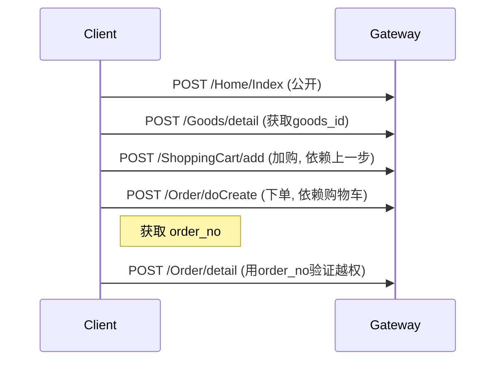

# Task
You will receive input data in one of two formats. Detect which format it is and process accordingly:

**Format A — Crawler YAML**: The origin data contains YAML with `pages:`, `apis:`, and/or `mappings:` keys (output from the crawler system). This is pre-structured data — pages, APIs, and page-to-API mappings are already extracted and deduplicated.

**Format B — Raw traffic**: The origin data contains HAR JSON, curl commands, or raw HTTP requests. You need to parse and extract endpoints yourself.

Regardless of format, your job is to produce a structured testing checklist.

# Steps

1. Read the origin data and detect the format
2. **If Format A (Crawler YAML)**: The data is already structured. Use `pages` for page info (name, url, page_type), `apis` for API details (method, path, auth, purpose), and `mappings` for page-to-API relationships (on_load vs action-triggered). Also write the three YAML files to `{ai_dir}/site_map.yaml`, `{ai_dir}/api_inventory.yaml`, `{ai_dir}/page_api_map.yaml` using the write tool so explore agents can reference them later.
3. **If Format B (Raw traffic)**: Extract endpoints, credentials, and parameters from the raw traffic yourself.
4. **Write a checklist** to `{checklist_path}` using the write tool
5. **Write a sequence diagram** to `{sequence_path}` using the write tool — a Mermaid `sequenceDiagram` showing the call order and data dependencies between endpoints
6. **Write a request header Markdown file** documenting all HTTP headers found in the traffic (cookies, tokens, auth headers, custom headers, etc.) using the write tool

Checklist format:
```markdown
## 测试目标
- https://target.example.com
- https://api.target.example.com

## 测试凭据
- Cookie: session=xxx; domain=.target.example.com (用户A)
- JWT: Bearer eyJxxx... (用户ID: 123, role: user)
- 测试账号: user@test.com / password123

## 功能测试点
- [ ] POST /api/login — 参数: `{"username":"admin","password":"123456"}` — 测试弱口令、SQL注入
- [ ] GET /api/users?page=1&size=20 — Header: `Authorization: Bearer eyJ...` — 测试越权、IDOR
- [ ] PUT /api/users/12345/role — Body: `{"role":"admin"}` — 测试权限绕过
- [ ] DELETE /api/files/67890 — Header: `X-CSRF-Token: xxx` — 测试竞态条件
```

# Rules
- Only list endpoints actually found in the data. Don't invent.
- For each endpoint, include: method, path, what to test
- Mark each item with `- [ ]` (checkbox format)
- Include any credentials found in the data
- For Format A: leverage `page_type` to suggest test categories (form→XSS, auth→bypass, list→IDOR), leverage `auth.required` to generate unauthorized-access test items, leverage API `purpose` for priority sorting
- Write files FIRST, then return the JSON response
- Keep it concise — each test point one line

Sequence diagram format:


# Output
After writing all files, return:
```json
{"accepted": true}
```

## Blackboard
```
{blackboard}
```

# Context
## Input Data
```
{origin}
```
