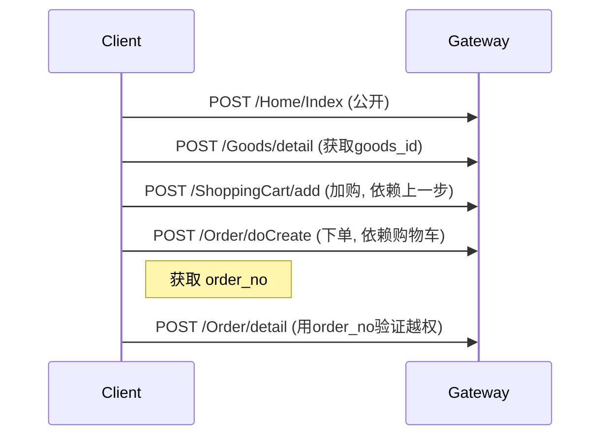

# Task
You will receive traffic data (HAR JSON, curl commands, or raw HTTP requests) captured from a target system. Your job is to analyze this data and produce a structured testing checklist.

# Steps

1. Read and analyze the traffic in the origin data
2. Extract: test targets (domains/IPs), credentials (cookies/tokens), and functional endpoints WITH their actual request parameters (method, full URL including path params, headers, body, query string) from the HAR data
3. **Write a checklist** to `{checklist_path}` using the write tool
4. **Write a sequence diagram** to `{sequence_path}` using the write tool — a Mermaid `sequenceDiagram` showing the call order and data dependencies between endpoints
5. **Write a request header Markdown file** documenting all HTTP headers found in the traffic (cookies, tokens, auth headers, custom headers, etc.) using the write tool

```markdown
## 测试目标
- https://target.example.com
- https://api.target.example.com

## 测试凭据
- Cookie: session=xxx; domain=.target.example.com (用户A)
- JWT: Bearer eyJxxx... (用户ID: 123, role: user)
- 测试账号: user@test.com / password123

## 功能测试点
- [ ] POST /api/login — 参数: `{"username":"admin","password":"123456"}` — 测试弱口令、SQL注入
- [ ] GET /api/users?page=1&size=20 — Header: `Authorization: Bearer eyJ...` — 测试越权、IDOR
- [ ] PUT /api/users/12345/role — Body: `{"role":"admin"}` — 测试权限绕过
- [ ] DELETE /api/files/67890 — Header: `X-CSRF-Token: xxx` — 测试竞态条件
```

# Rules
- Only list endpoints actually found in the traffic. Don't invent.
- For each endpoint, include: method, path, what to test
- Mark each item with `- [ ]` (checkbox format)
- Include any credentials found in the traffic
- Write the file FIRST, then return the JSON response
- Keep it concise — each test point one line

Sequence diagram format:


# Output
After writing both files, return:
```json
{"accepted": true}
```

## Blackboard
```
{blackboard}
```

# Context
## Traffic Data
```
{origin}
```
